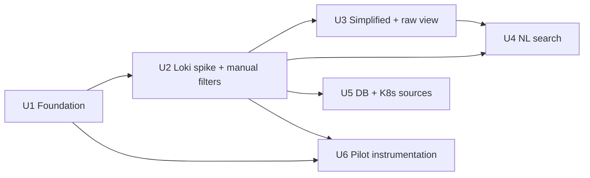

# Decisions: Tasks / Plan (Stage 5)

> **Instructions:** Review each decision point below. AI recommendations are provided for guidance. Fill in your decisions in the "Answer" sections, then confirm when ready to proceed.

AI-DLC Inception, Stage 5 (Plan). Created 2026-11-26, after Stage 4 approval (audit A-116). Status: **all 13 answered (2026-11-26); `tasks.md` generated 2026-11-26 (audit A-134)**.

**How to answer.** On each `**Answer:**` line write an option number, your own text, or an owner and due date if someone else must answer. You can also say "use recommendations for all except TD-xx: option 2". When done, say **"task decisions filled"**.

**Tags.** *Blocker for tasks.md* = `tasks.md` cannot be written without it. *Can-defer* = `tasks.md` uses the recommendation as an open working assumption.

---

## Already decided (inputs, not re-asked)

| Topic | Decision | Source |
|---|---|---|
| MVP slice order | Foundation and access → short Loki API spike + manual filters on one source using a real request → simplified and raw view → natural-language search → database and Kubernetes sources → pilot instrumentation as its own unit | Brief §3 Stage 5; T-001 (manual filters first, NL on top) |
| Unit workflow | Each unit runs as one or more Bolts: prepare → plan → build → verify → review | Brief §3 Stage 5; workshop deck |
| Spike amends the design | V-01..V-11 are assumptions; the spike results amend `design.md` through a versioned change entry | DD-01 (A-088) |
| Architecture | Go modular monolith + separate inference VM; PostgreSQL; Docker Compose; REST/JSON + OpenAPI + Pact | `design.md` v1.0 |
| Test layers | Pact via PactFlow, Playwright E2E (candidate), unit + properties P-a..P-f, Loki integration with masked fixtures | DD-24, DD-25 |
| Pilot | BCAS, UAT first, RC added in the pilot; fewer than 10 users; working-hours best effort | S-02, S-03, N-01, N-03 |
| Gates before specific work | V-01 (Loki access) before the spike; V-10 (masked log sample) before the parser build; DB limits approved by DevOps and Hadi Septian before the DB source is enabled; stack confirmed by Developers before U1 | V-01, V-10, D-03, H-04 |

## Proposed units of work (input for the decisions below)

| Unit | Scope | Main requirements | Depends on | Proposed owner role |
|---|---|---|---|---|
| U1 Foundation and access | Repository layout, CI with PactFlow, Compose deployment, PostgreSQL schema and migrations, local accounts, sessions, CSRF, RBAC grants, audit with hash chain, project/environment config, admin screens for accounts and grants | 1, 2, 3, 5, 26, 30 | Stack confirmed (H-04) | Developers (backend lead), DevOps |
| U2 Loki spike + manual filters | Run V-01..V-04, V-07 against BCAS UAT Loki; Loki connector; Source_Binding with approval; query builder and templates; WIB/UTC; windows and caps; manual filter chips; "nothing found"; first real request RQ-01 / RQ-05 end to end with raw lines | 4, 6, 7, 8, 9, 12, 14, 21 | U1; V-01 done; read-only access approved (Yosia Alvin + DevOps) | Developers, DevOps |
| U3 Simplified and raw view | Parser rules registry and default BCAS rule set; Simplified_View fields; Raw_View; masking (key + value rules); copies; Unmask_Right and True_Raw; dictionary and identifier mapping screens | 11, 15, 16, 17, 18, 19, 20 | U2; V-10 masked sample | Developers, BA (dictionary, mapping) |
| U4 Natural-language search | Pre-processor, inference VM, model evaluation on the RQ-01..RQ-24 test set, Filter_Set schema validation, fallback; Search_History and "minta log lagi" guidance | 10, 13 | U2 (U3 for full value); inference VM (DD-10) | Developers, System Architect, DevOps |
| U5 Database and Kubernetes sources | V-06, V-08; Kubernetes through Loki for UAT/RC; DB connector with limits after approval; cross-service grouping and fallback linking (V-05) | 22, 23, 24 | U2; V-06, V-08; D-03 approval | Developers, DevOps |
| U6 Pilot instrumentation | Metric events, PM page, CSV, ping entry, MET-04 classification; escalation and Escalation_Link; outage records; baseline count from the 3-month chat export | 25, 27, 28, 29 | U1 (events can start with U2) | Developers, PM, BA |

---

## 1. Implementation strategy

### TD-01 Unit breakdown

**Tag:** Blocker for tasks.md · **Owner:** System Architect, PM

**Question:** Do you accept U1–U6 above as the units of work?

**Why this matters:** Units become the Construction plan, deck slide 8 and the order of Bolts.

**Options:**
1. **Accept U1–U6 as proposed — Recommended:** *Rationale:* follows the MVP order the brief and the team set; each unit ends in something demonstrable.
2. **Merge U1 and U2 into one "walking skeleton" unit:** faster first demo; a larger first Bolt.
3. **Split U3 into "parser and views" and "masking and unmask":** smaller units; security work reviewed on its own.
4. Other (please specify): _______________________

**Answer:**1

### TD-02 MVP slice and pilot start

**Tag:** Blocker for tasks.md · **Owner:** PM, System Architect

**Question:** Which units must be done before BCAS pilot users start?

**Why this matters:** It sets the pilot start date and what "bare minimum" means (presenter deck p.9: simplified finder is the bare minimum, NL on top is the end-goal MVP).

**Options:**
1. **Pilot starts after U1, U2, U3 and U6 (bare minimum + measurement); U4 and U5 join during the pilot — Recommended:** *Rationale:* measurement from day one, and the hypothesis needs a baseline; NL usage share is still measured once U4 lands.
2. **Pilot starts only after all of U1–U6:** the full MVP from day one; later start.
3. **Pilot starts after U1–U3 without instrumentation:** earliest start; no pilot data for the first weeks.
4. Other (please specify): _______________________

**Answer:**1

### TD-03 Slice style inside units

**Tag:** Can-defer · **Owner:** Developers

**Question:** How is work sliced inside a unit?

**Why this matters:** It decides when a Bolt shows something working.

**Options:**
1. **Vertical slices (UI + API + backend for one behavior per task) — Recommended:** *Rationale:* every task ends in a testable behavior traced to a requirement.
2. **Horizontal layers (backend first, then UI):** fewer context switches; later feedback.
3. Other (please specify): _______________________

**Answer:**1

### TD-04 Test timing

**Tag:** Can-defer · **Owner:** QA, Developers

**Question:** When are tests written relative to code?

**Why this matters:** It sets the evidence each Bolt produces.

**Options:**
1. **Test-first for pure logic and properties (P-a..P-f) and for Pact contracts; tests alongside code for UI and integration — Recommended:** *Rationale:* the security and correctness core is pinned before code; UI is easier to test once it exists.
2. **Test-first for everything:** strictest; slower first Bolts.
3. **Tests after implementation in each Bolt:** fastest coding; weakest evidence.
4. Other (please specify): _______________________

**Answer:**1

## 2. Granularity and parallel work

### TD-05 Task granularity

**Tag:** Can-defer · **Owner:** Developers

**Question:** How fine are the tasks in `tasks.md`?

**Why this matters:** Each task should fit one agent request or one developer session.

**Options:**
1. **Fine: about 30–45 tasks across U1–U6, each tied to requirement numbers — Recommended:** *Rationale:* matches "each task small enough for a single agent request" and keeps traceability.
2. **Coarse: 10–15 tasks:** less overhead; each task is large.
3. Other (please specify): _______________________

**Answer:**2

### TD-06 Parallel workers

**Tag:** Blocker for tasks.md · **Owner:** PM, Developers

**Question:** How many people or agent instances work in parallel during Construction?

**Why this matters:** `tasks.md` is organised in waves of groups that never touch the same files; the group count follows from this.

**Options:**
1. **Three Developers (backend, frontend, one floating) plus DevOps for infrastructure groups — Recommended:** *Rationale:* the team has three Developers and one DevOps; groups split by `/backend`, `/frontend`, `/deploy`.
2. **Two parallel workers:** simpler coordination; longer plan.
3. **One worker (sequential):** no file conflicts; slowest.
4. Other (please specify): _______________________

**Answer:**2

## 3. Owners and dates

### TD-07 Owner per unit

**Tag:** Blocker for tasks.md · **Owner:** PM

**Question:** Who owns each unit (named person)?

**Why this matters:** The brief and deck slide 8 need an owner per unit; each Bolt review needs a human owner.

**Options:**
1. **Fill in names:** U1 ___, U2 ___, U3 ___, U4 ___, U5 ___, U6 ___ (suggestion by role: U1 a backend Developer with DevOps Hadi Septian; U2 a backend Developer with DevOps; U3 a Developer with a BA; U4 a Developer with the System Architect William Tanardi; U5 a Developer with DevOps; U6 a Developer with PM and QA Bimas Nugraha) — Recommended
2. **PM assigns after Inception; tasks.md shows roles only:** faster now; slide 8 incomplete.
3. Other (please specify): _______________________

**Answer:**2

### TD-08 Construction start and target dates

**Tag:** Blocker for tasks.md · **Owner:** PM

**Question:** When does Construction start, and what is the target date per unit?

**Why this matters:** Slide 8 asks for target dates and the Construction start date; open decisions need due dates (brief §1.7).

**Options:**
1. **Start date ___; target dates per unit ___ (PM fills in) — Recommended:** *Rationale:* only the PM knows team availability; the AI does not estimate dates.
2. **Relative plan only (e.g. "U2 two weeks after U1"); dates set at the review gate:** no commitment yet.
3. Other (please specify): _______________________

**Answer:**2

## 4. Deployment, rollback, CI/CD

### TD-09 Deployment approach

**Tag:** Can-defer · **Owner:** DevOps

**Question:** How often is the Finder deployed to the internal server during Construction?

**Why this matters:** Early deploys find network and access problems (V-01) before the pilot.

**Options:**
1. **Deploy at the end of each unit to the internal server, with a smoke test; U2 deploys before its review to reach BCAS UAT Loki — Recommended:** *Rationale:* the Loki network path only exists from the internal server.
2. **Deploy once before the pilot:** less work; network surprises found late.
3. Other (please specify): _______________________

**Answer:**1

### TD-10 Rollback granularity

**Tag:** Can-defer · **Owner:** DevOps

**Question:** How is a bad release rolled back?

**Why this matters:** Users fall back to asking engineers, but data (audit) must survive.

**Options:**
1. **Per release: previous image tag via Compose; database migrations forward-only and backward compatible for one release; audit table never rolled back — Recommended:** *Rationale:* one command to roll back; audit chain stays intact.
2. **Full rollback including database restore from backup:** simplest to reason about; loses audit entries since the backup.
3. Other (please specify): _______________________

**Answer:**1

### TD-11 CI/CD maturity

**Tag:** Can-defer · **Owner:** DevOps, Developers

**Question:** How far does the pipeline go automatically?

**Why this matters:** H-04 requires PactFlow in CI/CD; deployment to the internal server may need manual steps.

**Options:**
1. **Automatic: build, unit + property tests, Pact publish and can-i-deploy, image build; manual approval step to deploy to the internal server — Recommended:** *Rationale:* fast feedback; a human decides each deploy (workshop: DevOps owns production-like decisions).
2. **Fully automatic deploy on main:** fastest; no human gate.
3. **Manual builds and deploys:** least setup; no contract gate.
4. Other (please specify): _______________________

**Answer:**2

## 5. Definition of Done

### TD-12 Definition of Done per unit

**Tag:** Blocker for tasks.md · **Owner:** QA, System Architect

**Question:** When is a unit done?

**Why this matters:** It is the verification evidence each unit's Bolt must show at review.

**Options:**
1. **All unit acceptance criteria pass; unit tests, properties and Pact verification green in CI; E2E for the unit's flows green; deployed to the internal server and smoke-tested; no unmasked value in logs (log-hygiene test); audit entries checked; review by the unit owner and QA; `design.md` amended if a verification changed an assumption — Recommended**
2. **Option 1 without the deploy and smoke test:** faster; integration problems found later.
3. **Tests green and code reviewed only:** lightest; weakest evidence.
4. Other (please specify): _______________________

**Answer:**1

## 6. Open decisions to carry into the plan

### TD-13 Owners and due dates for open items

**Tag:** Blocker for tasks.md · **Owner:** PM

**Question:** Who closes each open item, and by when? (Brief §1.7: every open blocker needs an owner and a due date.)

**Why this matters:** These items gate specific units.

| Item | Gates | Proposed owner | Due date |
|---|---|---|---|
| H-04 stack confirmation | U1 start | Developers | ___ |
| V-01 Loki access path (§6 checklist) | U2 | DevOps Hadi Septian | ___ |
| Read-only Loki access approval for BCAS UAT | U2 | Yosia Alvin + DevOps | ___ |
| V-10 masked raw-log sample | U3 parser | DevOps or a Developer | ___ |
| Inference VM (DD-10) | U4 | DevOps | ___ |
| V-06 pod logs in Loki; V-08 DB engine and tables | U5 | DevOps, Developers | ___ |
| DB limits approval (D-03) | U5 DB source | DevOps, Hadi Septian | ___ |
| 3-month chat export and ping count (MET-01) | U6, pilot start | PM, BA | ___ |
| Audit retention (OI-05) | before pilot | PM, compliance | ___ |
| Loki retention (V-07) | U2 | DevOps | ___ |

**Options:**
1. **Accept the proposed owners; PM fills in the due dates — Recommended**
2. **Change owners (write them in the table) and fill in due dates**
3. Other (please specify): Accept the proposed owners, but due date decided later at task execution.

**Answer:**3

---

## Decision index

| ID | Title | Tag | Owner |
|---|---|---|---|
| TD-01 | Unit breakdown | Blocker | System Architect, PM |
| TD-02 | MVP slice and pilot start | Blocker | PM, System Architect |
| TD-03 | Slice style inside units | Can-defer | Developers |
| TD-04 | Test timing | Can-defer | QA, Developers |
| TD-05 | Task granularity | Can-defer | Developers |
| TD-06 | Parallel workers | Blocker | PM, Developers |
| TD-07 | Owner per unit | Blocker | PM |
| TD-08 | Construction start and target dates | Blocker | PM |
| TD-09 | Deployment approach | Can-defer | DevOps |
| TD-10 | Rollback granularity | Can-defer | DevOps |
| TD-11 | CI/CD maturity | Can-defer | DevOps, Developers |
| TD-12 | Definition of Done | Blocker | QA, System Architect |
| TD-13 | Owners and due dates for open items | Blocker | PM |

Blockers: 7 (TD-01, 02, 06, 07, 08, 12, 13). Can-defer: 6 (TD-03, 04, 05, 09, 10, 11).
