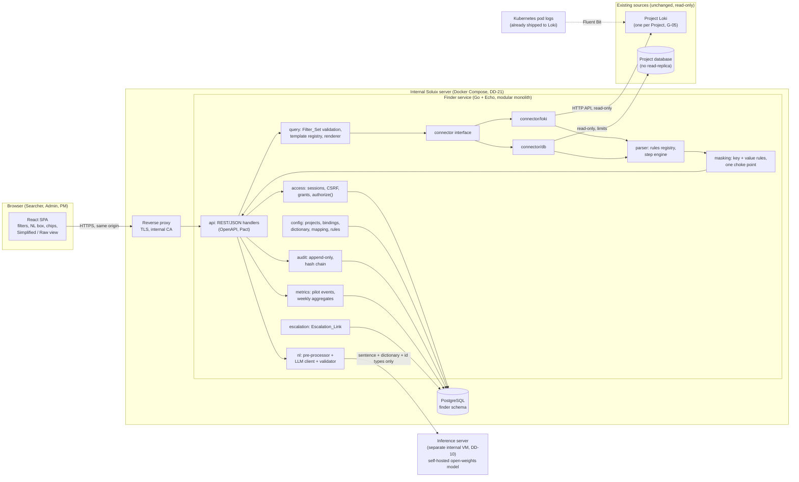
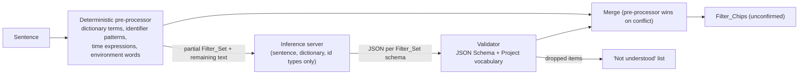
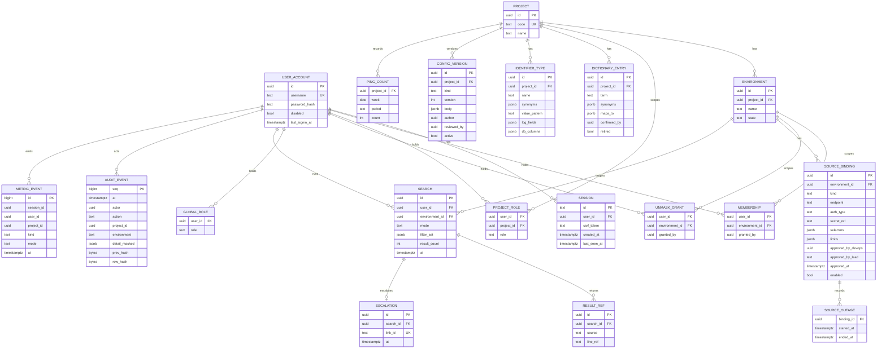
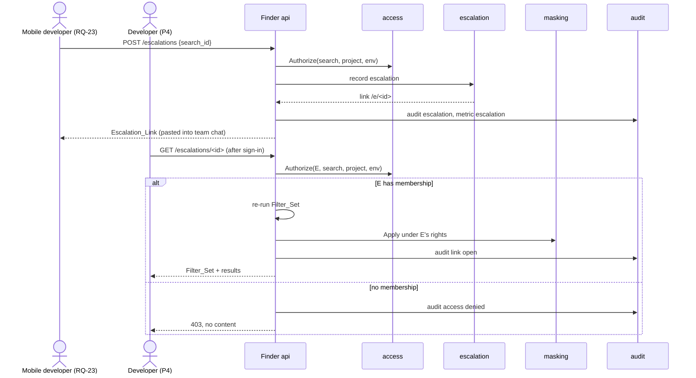
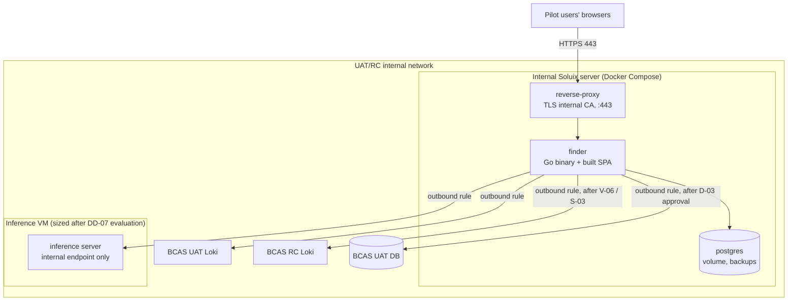

# Design Document

## Overview

AI-DLC Inception, Stage 4 (Design). Status: **Approved 2026-11-26 (audit A-116)** (generated 2026-11-26 from `_decisions-design.md`, all 26 decisions answered; audit A-108 to A-115).

This document describes how the Simplified Log Finder ("the Finder") meets the approved requirements in `requirements.md` (Requirements 1–31). Every design choice traces to a decision in `_decisions-design.md` (DD-01..DD-26) or to an earlier Stage 2 decision (IDs from `aidlc-docs/inception/stage2-questions.md`). The decision log at the end maps each DD to the section that applies it.

**What the Finder is.** A thin, input/output-agnostic layer in front of the sources Soluix teams already use (G-01, A-042). It turns a Searcher's filters or sentence into predefined, parameterized queries; runs them server-side with a read-only identity per Project and Source; parses the results deterministically; masks them; and shows a simplified view with the raw log one click away. It does not replace Grafana, the database or k9s for engineers (C4, Req 31) and changes nothing in those tools other than a read-only access grant (Req 31.1).

**Build vs reuse (recap of G-01 and Stage 2 §5).**

| Option | Outcome |
|---|---|
| Reuse as-is (Grafana for BA/QA) | Rejected by the team (T-002): security risk, logs stay unreadable |
| Hybrid: thin Finder over the Loki HTTP API and the database, build only the differentiators | **Chosen** (G-01, A-042). Each new source gets its own design discussion (SC-3) |
| Replace stack (e.g. OpenObserve) | Not adopted: conflicts with C4 and "not a new observability platform" |
| Build from scratch | Not adopted: same conflict |
| Grafana MCP server / Grafana Assistant | Optional; not required by the MVP (G-02, G-03, Req 31.3). Assistant likely unavailable on self-hosted Grafana (X-003) |

**What is built (differentiators).** Business-term dictionary and identifier mapping per Project; NL-to-filter layer; template-based query builder; deterministic parser with a per-Project rules registry; masking; audit; access and grants; pilot instrumentation; a non-technical UI with editable filter chips.

**Explicit assumptions (DD-01 = 1).** The technical verifications V-01..V-11 have not been run. This design is approved with their current working values as assumptions (next section). The Loki spike (unit U2 in Stage 5) runs them; results amend this document through a versioned entry in the Change log section plus an audit row.

## Assumptions and Verifications

Each row is a working value this design relies on. "Sections affected" names the parts that change if the verification disproves the value.

| ID | Verification | Working value used in this design | Owner | Sections affected | Blocks |
|---|---|---|---|---|---|
| V-01 | Loki access path and auth from the Finder host (§6 checklist a–d in `stage2-actors-constraints-assumptions.md`) | Direct to the Project's Loki, no authentication, network-restricted (G-04, unverified per C-08). Connector still supports none/basic/bearer and custom headers (Req 21.3) | DevOps (Hadi Septian); backup System Architect | Loki connector; Security model (RK-002) | Loki spike U2 |
| V-02 | Loki version; behavior of `query_range`, `labels`, `label values`, `limit`, `direction`, `X-Scope-OrgID` | Standard Loki HTTP API endpoints `/loki/api/v1/query_range`, `/loki/api/v1/labels`, `/loki/api/v1/label/<name>/values`; `limit` and `direction` honored | DevOps, Developers | Loki connector; Pagination | U2 |
| V-03 | Identifiers only inside log lines for BCAS UAT/RC | Inside lines, not labels (M-02) | DevOps | Query templates | — |
| V-04 | Environment-to-label mapping for BCAS UAT/RC and full label list | Mapping held per binding; values unknown. Screenshot shows `cluster`, `job`, `kubernetes_container_name` (+3 hidden) and payload `project_name` that disagrees with `cluster` [Ideation p.17] | DevOps | Source_Binding content | BCAS binding |
| V-05 | `X-Request-Id` / `traceparent` propagated between BCAS services | Unconfirmed; fallback linking off per Project until confirmed | Developers | Cross-service grouping | Req 24.3 only |
| V-06 | Loki holds UAT and RC pod logs | Unconfirmed; Kubernetes source "not yet available" until confirmed (Req 22.4) | DevOps | Kubernetes through Loki | Req 22; RC enablement |
| V-07 | Loki retention per Environment | TBD; parameter `loki_retention` per binding; Max_Range never exceeds it | DevOps | Parameters; Req 22.3 message | — |
| V-08 | Database engine, schemas, tables for RQ-01..RQ-24 | Unknown; DB connector designed behind the connector interface with a driver chosen after V-08 | Developers, DevOps | DB connector | U5 |
| V-09 | FE/Mobile developers' Grafana access today | Unknown; no design impact (persona P3 rights review only) | PM, BA | — | — |
| V-10 | Masked text export of raw BCAS log lines plus full label list | Screenshot only; default BCAS rule set is derived from the screenshot and must be re-validated | DevOps or a Developer | Parser default rule set; parser fixtures | Parser build U3 |
| V-11 | Grafana MCP server / Assistant availability | Not used in the MVP | System Architect, DevOps | — | Nothing |

## Architecture

### Component view

DD-02 = 1: one Go (Echo) service built as a modular monolith, plus the inference server as a separate process on its own VM (DD-10 = 1). The React SPA is served by the same Go binary on the same origin (DD-21 = 1).



Grafana stays in front of the same Loki for engineers. The Finder does not call Grafana in the MVP (Req 31.3, 31.4).

### Package responsibilities

| Package | Responsibility | Requirements |
|---|---|---|
| `api` | HTTP handlers, request/response DTOs, OpenAPI contract, error envelope. Calls `access.Authorize` before every handler that touches a Project | 1–27 |
| `access` | Local accounts, argon2id hashes, server-side sessions, CSRF, RBAC tables, the single `Authorize` function | 1, 2, 3, 20 |
| `config` | Projects, Environments, Source_Bindings (non-secret part), dictionary, Identifier_Mapping, Masking_Rules, parser rule sets, view fields, parameters; versioned changes with audit | 5, 11, 12, 16, 19.4 |
| `nl` | Deterministic pre-processor, inference client, JSON Schema validation, vocabulary check | 9, 10 |
| `query` | Filter_Set model and validation, time conversion, window bounding, template registry, template rendering with binding injection and value escaping | 4, 6, 7, 8, 13 |
| `connector` | One `Connector` interface; implementations `loki` and `db`; Kubernetes served by `loki` | 21, 22, 23, 31.5 |
| `parser` | Per-Project rules registry; fixed set of step types; deterministic execution; "could not be simplified" state | 15, 16, 17 |
| `masking` | Applies Masking_Rules to every response DTO before serialization; True_Raw only via a separate endpoint | 18, 19, 20 |
| `audit` | Append-only Audit_Log with hash chain and verification | 26 and every audited action |
| `metrics` | Pilot events, weekly aggregates, PM page data, CSV export, outage records | 27, 29.3 |
| `escalation` | Escalation records and Escalation_Link resolution with access re-check | 25 |

Packages depend on interfaces, not on each other's internals, so the repository can later split along package lines (R-01, SC-2).

### Repository layout (SC-2, R-01)

```
/backend      Go module: cmd/finder, internal/<package>, migrations/, openapi/
/frontend     React + Vite SPA, Pact consumer tests, Playwright E2E
/deploy       docker-compose.yml, reverse-proxy config, finder.env.example (no real values), runbooks
/fixtures     masked log fixtures (from V-10), NL test set built from RQ-01..RQ-24 (placeholders only)
```

The stack in SC-1 (Go + Echo; TypeScript, React, Vite, TanStack Router/Query/Virtual, Tailwind, shadcn/ui, lucide-react; PactFlow) is used as decided, **still to confirm with Developers** (H-04).

## Components and Interfaces

### Access and sessions (DD-17, DD-18, DD-19)

- **Passwords:** argon2id via `golang.org/x/crypto/argon2`; salt per password; parameters (memory, iterations, parallelism) in configuration, set from current OWASP Password Storage guidance at build time (DD-17, Req 1.5).
- **Sessions:** server-side rows in `session`; opaque random session ID (at least 128 bits) in a cookie with `HttpOnly`, `Secure`, `SameSite=Strict`; idle timeout parameter `session_idle_timeout`, **default 30 minutes (proposal, N-014)**; every request extends `last_seen_at` (Req 1.4). Disabling or removing an account deletes its session rows in the same transaction, so the next request is unauthenticated (Req 2.2).
- **CSRF:** a per-session CSRF token returned by `GET /api/v1/session` and required in the `X-CSRF-Token` header on every state-changing call (POST, PUT, PATCH, DELETE).
- **Sign-in failures:** generic message "username or password is incorrect" (Req 1.2); failed attempts audited; a lockout or delay after repeated failures is a parameter `signin_failure_delay` (proposal, see open items).
- **Grants (DD-19 = 1):** role names fixed in code; who holds them is configuration.

| Table | Meaning | Grants |
|---|---|---|
| `membership(user, project, environment)` | User may search that Project and Environment | Req 3.2 |
| `project_role(user, project, role)` with role ∈ {`business_admin`, `access_admin`} | P5a / P5b per Project | Req 5.5 |
| `unmask_grant(user, project, environment)` | Unmask_Right, off by default, any user eligible | Req 20.1–20.2, C-05 |
| `global_role(user, role)` with role ∈ {`pm`, `system_architect`} | Pilot metrics and Audit_Log reading | Req 26.3, 27 |

`Authorize(ctx, user, action, project, environment)` is the only authorization function. It reads grants from the database on every request (no grants in the session or cookie), so a revocation applies to the next request (Req 3.6). Denials return the access-denied envelope with no content or counts and are audited (Req 3.4).

**Parser rules editor (N-013 f, proposal).** M-04 does not cover parser rules. This design gives them to `access_admin` (Project Admin, DevOps half), with a Developer review recorded on the rule set version before it can be activated. Confirm at Stage 4 review.

### Per-Project configuration (Req 5)

Configuration is stored per Project in PostgreSQL (DD-15): relational rows for things that are joined or granted, JSONB for per-Project documents. Every change writes a new version row and an audit entry with the previous value (Req 5.4). Onboarding a Project needs only configuration (Req 5.2).

| Item | Storage | Edited by | Notes |
|---|---|---|---|
| Project, Environments | `project`, `environment` | access_admin | Environment state: `not_available` until a binding is approved (Req 5.6) |
| Source_Binding (non-secret) | `source_binding` | access_admin | endpoint, auth type, header names, `secret_ref`, label selectors, payload filter, limits, approval |
| Business_Term_Dictionary | `dictionary_entry` | business_admin; Developer confirms | `confirmed_by`, `confirmed_at`; unconfirmed shown as "unconfirmed mapping" (Req 11.2–11.3) |
| Identifier_Mapping | `identifier_type` | business_admin | name, synonyms, value pattern (RE2), log field paths, DB columns (Req 12) |
| Masking_Rules | `masking_rule_set` (JSONB, versioned) | access_admin | key rules and value rules (DD-13) |
| Parser rule set | `parser_rule_set` (JSONB, versioned) | access_admin + Developer review | ordered steps (DD-11, N-013) |
| Simplified_View fields | `view_fields` (JSONB, versioned) | business_admin | default list per Req 16.1 |
| Parameters | `project_params` (JSONB, versioned) | access_admin | windows, caps, timeouts (Parameters section) |

### NL-to-filter layer (DD-07, DD-08, DD-09)



- **Pre-processor:** matches dictionary terms and synonyms, identifier values by the Project's value patterns (e.g. 9-digit CIF, 64-hex hashcard), time expressions ("jam 16:04:44", "around 15.11", "11:22 - 11:23", "tadi", "kemarin sore"), and environment words (UAT, RC). Exact matches here are not sent to the LLM for re-interpretation.
- **LLM request:** the sentence, the Project dictionary terms and identifier type names. **Never log content** (Req 10.3, L-01). The inference server runs on a separate internal VM (DD-10); candidate servers and open-weights models are evaluated against the NL test set from RQ-01..RQ-24 and brief §2 (Req 10.7). No model is chosen in this document.
- **Validation (DD-08):** the Filter_Set JSON Schema (below) is passed for constrained output where the server supports it, and the response is always validated server-side against the schema and the active Project's vocabulary. Unknown fields, terms or invalid values are dropped and reported (Req 10.5). The same validator checks manual filters (Req 6.5).
- **No query text:** the schema has no field for LogQL, SQL or free query text; the renderer only accepts a validated Filter_Set (Req 10.1, C2).
- **Unavailable or slow LLM (DD-09):** timeout parameter `nl_timeout` (proposal 10 s). On timeout or error the UI shows "natural-language search unavailable, use filters", and chips from the pre-processor are still shown. The search mode is still recorded (Req 10.6).

**Filter_Set schema (summary).**

| Field | Type | Rule |
|---|---|---|
| `environment` | enum `UAT` / `RC` | must be granted to the user |
| `time_window` | `{start, end}` WIB local datetimes, or `{anchor, kind}` with kind ∈ exact / approximate / vague | vague requires confirmation (Req 9) |
| `identifiers[]` | `{type, value}` | type from Project Identifier_Mapping; value matches its pattern |
| `features[]` | dictionary entry IDs | must exist in the Project dictionary |
| `message_text[]` | strings | length cap parameter; escaped by the renderer |
| `error_code` | string | pattern parameter per Project |
| `sources[]` | enum `loki` / `db` | only enabled bindings |

### Query builder and templates (DD-04, DD-05, DD-06)

- **Time handling (Req 8):** inputs are WIB (UTC+07:00, no DST); the renderer converts to UTC Unix nanoseconds for Loki and to UTC timestamps for SQL. Display converts back to WIB with the label "WIB". Raw views keep original timestamps.
- **Window rules (Req 7, 9):** exact time → `anchor ± exact_window`; approximate → `anchor ± approx_window` (or the given range); no date → today in WIB, shown on the chip; vague → proposed window, query blocked until confirmed; window longer than `max_range` → refused with the limit stated. `max_range` never exceeds `loki_retention` (V-07).
- **Template registry:** templates are Go code with typed parameters, versioned and listed per Source. The registry has no runtime path to add free query text.
- **Loki template (DD-04 = 1):** stream selector from the Source_Binding (injected server-side, never from user input) plus line filters:
  - one value: `{<binding selectors>} |= "<escaped value>"`
  - several values of one type (e.g. three CIFs, Req 6.2): either `|~ "(?:<v1>|<v2>|<v3>)"` with each value passed through a RE2 quote function, or one query per value. Which form is used is decided in the spike (V-02); both are implemented behind the same template.
  - feature from the dictionary: a selector label where the entry maps to one (e.g. container name), otherwise a line filter on the mapped endpoint or message pattern.
  - message text: escaped `|=` filter.
  All values are escaped by the template engine; string concatenation of user input into LogQL is forbidden and covered by property (f).
- **Binding guard (Req 4.3):** after rendering, the renderer checks that the binding's selectors are present in the rendered query; if not, execution is refused and audited.
- **Result_Cap (DD-05 = 1, proposal):** one `query_range` call with `limit = result_cap + 1`, fixed `direction` (proposal: `backward`, newest first; confirm in spike). If `result_cap + 1` lines return, show `result_cap` lines and the "more matches exist, narrow the search" message (Req 7.5).
- **Multi-value labelling (Req 6.2):** after fetch, each line is labelled with the identifier value(s) it contains.

### Source connectors (Req 21–23, 31.5)

One interface for every source, so new sources (and image input next phase) plug in without changing existing ones (Req 31.5, C9):

```go
type Connector interface {
    Kind() SourceKind                                   // loki, db
    Check(ctx context.Context, b Binding) Health        // readiness, outage detection (Req 29.3)
    Execute(ctx context.Context, b Binding, q RenderedQuery) (RawResultSet, error)
}
```

**Loki connector.**
- HTTP client per binding: base URL, auth type `none` / `basic` / `bearer`, optional headers such as `X-Scope-OrgID` (Req 21.3); secrets resolved from `secret_ref` at call time (DD-20).
- Read-only endpoints only: `query_range`, `labels`, `label values`, `/ready` (Req 21.5).
- Timeout `loki_timeout` (proposal 30 s); concurrency per binding `loki_concurrency` (proposal 2); errors and timeouts → "Source failed" for Loki (Req 14.3, 21.4).
- Environment mapping (M-08): label selectors per Environment plus optional payload filter such as `project_name` applied as an escaped line filter. BCAS values come from V-04.
- **Kubernetes through Loki (K-01):** a Project's "Kubernetes" source is the Loki connector with pod/container labels shown on results (Req 22.2). Enabled per Environment only after DevOps confirms coverage (V-06); otherwise "not yet available" (Req 22.4). Requests older than `loki_retention` get the retention message (Req 22.3).

**Database connector.**
- Driver chosen after V-08 (engine unknown). Read-only, parameterized SQL templates only, for the tables listed per Project (Req 23.1).
- Per binding: statement timeout, row cap, max time range, concurrency (proposals: 5 s, 200 rows, 7 days, 1). Timeout is enforced both client-side (context) and server-side where the engine supports a statement timeout, and the query is cancelled at the database (Req 23.4).
- Concurrency limit reached → refuse with "retry later" (Req 23.5).
- Disabled until DevOps and the DB owner (BCAS: Hadi Septian) record approval of the limits (Req 23.3, D-03). No read-replica exists (D-02), so these limits protect the primary used by UAT/RC testers.

### Parser and renderer (DD-11 = 2, N-013)

- **Rules registry:** each Project has a versioned parser rule set: an ordered list of steps, each chosen from a fixed set of step types implemented in code. Configuration cannot contain code.

| Step type | Parameters | Example (BCAS default, from the screenshot, to re-validate with V-10) |
|---|---|---|
| `unwrap_json_field` | field name | take `log` from the Fluent Bit JSON line |
| `strip_prefix` | prefix pattern (RE2) | remove `<UTC ts>Z stdout F ` CRI prefix |
| `strip_ansi` | — | remove `\u001b[..m` color codes |
| `split_fields` | separator, names | split tab-separated app timestamp, level, source, message, payload |
| `unwrap_escaped_json` | field name | parse the escaped payload with `project_name`, `project_module`, `module_version`, `correlation_id`, `log_data` |
| `regex_extract` | named-group RE2 pattern, target fields | extract `X-Request-Id`, `traceparent` from `log_data` headers |
| `select_fields` | field paths, display names | view fields per Req 16 |

- **Determinism:** steps are pure functions of (raw line, rule set version). Regexes use Go `regexp` (RE2, linear time), so a bad pattern cannot hang the parser (N-013 d).
- **Validation before saving:** a rule set is accepted only if it parses, uses known step types, compiles every pattern, and passes the parser properties (c) against the Project's fixture lines (N-013 c, e). BCAS ships with the default rule set above (N-013 c).
- **Failure:** a line that fails any step is shown in the Raw_View with "could not be simplified" (Req 15.4, N-013 a).
- **Text preservation:** message text, including Indonesian text, is not changed apart from the configured removals (Req 15.5).
- **Raw_View:** pretty-printed from the original line (unwrapped JSON shown indented) with every field path kept (Req 17.2, 17.5); original timestamps kept (Req 17.4).

### Masking (DD-12 = 1, DD-13 = 1, DD-14 = 1)

- **One choke point:** `masking.Apply(dto, user, project, environment, mode)` runs on every response DTO in the `api` layer before JSON serialization: results, Raw_View, copies, Escalation_Link views, audit views (Req 19.1). Handlers cannot serialize a result DTO without passing through it (enforced by type: handlers receive `MaskedResult`, which only `masking` can construct).
- **True_Raw:** served only by `GET /api/v1/results/{id}/true-raw`, which checks `unmask_grant` for the Project and Environment and writes an audit entry before returning (Req 18.3, 20.3–20.4). Unmasked data is held in memory for the request only; nothing unmasked is written to logs, audit, metrics or caches.
- **Rules (DD-13):** key rules (JSON field paths or names such as `token`, `BodyRaw`, document body fields → full mask) and value rules (named RE2 pattern per identifier type → partial mask). Default partial pattern keeps the last 4 characters (**proposal**, PM to confirm), e.g. `•••••1234` (illustrative value).
- **Searched identifier (DD-14 = 1):** exact matches of the values the Searcher typed are shown in full in that Searcher's response only; in copies they stay masked unless the copy type is unmasked (Req 19.3).
- **Toggle:** shown only to holders of the Unmask_Right; every switch-off audited; masking returns on for each new search and Session (Req 20.3–20.5).
- **Copies leaving Soluix:** not detected; copies are audited only (Req 19.6, SEC-05).

### Audit (DD-16 = 1)

- Table `audit_event` is append-only. The application database role has `INSERT` and `SELECT` only on it; `UPDATE`, `DELETE` and `TRUNCATE` are revoked; migrations run under a separate owner role (Req 26.4).
- **Hash chain:** each row stores `prev_hash` and `row_hash = SHA-256(prev_hash || canonical_json(row without row_hash))`. Inserts are serialized (advisory lock) so the chain is linear. A verification job (`finder audit verify`, scheduled daily and on demand) recomputes the chain and reports the first broken row. This detects edits by someone with database admin rights.
- **Contents:** per Req 26.1–26.2 (search with masked Filter_Set or sentence, search mode, result count; raw opens; copies with type; unmask and True_Raw; escalations and link opens; access-denied; sign-in failures; configuration and grant changes with previous value).
- **Readers:** `pm` and `system_architect` global roles only (Req 26.3).
- **Retention:** parameter `audit_retention`, value TBD by compliance (OI-05). Until set, nothing is deleted. Deletion after retention, when defined, runs under the owner role and records a chain checkpoint so verification still works.

### Escalation (Req 25, DD-14, C-07)

- `POST /api/v1/escalations` records user, time, Project, Environment, Filter_Set and result count, and returns an Escalation_Link `https://<finder-host>/e/<random id>`.
- Opening the link requires sign-in, re-checks `membership` for the viewer, then re-runs the escalated Filter_Set under the viewer's own masking rights. No grant → access denied with no content (Req 25.2–25.3). This is the only shareable link in the MVP (Req 25.4).

### Pilot metrics (DD-23 = 1)

- Table `metric_event` (search, view_open, raw_open, copy, escalation, session_start, session_end) per Project, Session and user.
- Weekly aggregates computed on read for the PM page: searches, self-served, escalated, NL share, median and p90 of time to readable log (Req 27.1–27.4).
- PM enters weekly ping counts (baseline and pilot) counted outside the Finder (Req 27.5); the page shows the reduction and classifies with MET-04 thresholds, with "unclassified: PM decision needed" for out-of-threshold results (Req 27.6–27.7, OI-06).
- CSV export of the weekly table for the deck and offline review.
- Source outages (start, end, Source) recorded from connector health checks and failures (Req 29.3).

## Data Models



Notes:
- `CONFIG_VERSION.kind` ∈ {masking_rules, parser_rules, view_fields, params}; exactly one active version per kind and Project. Parser rule sets need `reviewed_by` (a Developer) before `active` (N-013 f).
- `SEARCH.filter_set` stores the validated Filter_Set; identifier values are stored masked per Masking_Rules for history display, plus a keyed hash so the owner's Search_History can re-run them (the full value is re-entered or recovered only for the owner; Req 13.4). **Proposal:** store full identifier values for the owner's history encrypted with a server key; confirm at review (open item).
- `RESULT_REF.line_ref` holds the Source reference needed to re-fetch a line for True_Raw (Loki stream labels + timestamp + line hash); log content is not stored in the Finder database.
- `SOURCE_BINDING.secret_ref` names a secret file or environment variable on the host (DD-20); the secret itself is never stored in the database.

## API Contract

REST/JSON under `/api/v1`, documented in `backend/openapi/finder.yaml` and pinned by Pact consumer tests (frontend) and provider verification (Go) through PactFlow (DD-03 = 1). All responses use `Content-Type: application/json`. State-changing calls need the session cookie and `X-CSRF-Token`.

**Error envelope.** `{ "error": { "code": "<machine code>", "message": "<human text>", "details": {...} } }`. Access-denied responses carry no result counts or content (Req 3.4).

| Method and path | Purpose | Request (summary) | Success | Errors |
|---|---|---|---|---|
| `POST /api/v1/session` | Sign in | `{username, password}` | 200 `{user, projects[], csrf_token}` + cookie | 401 `invalid_credentials` (generic), 403 `account_disabled` |
| `GET /api/v1/session` | Current session | — | 200 `{user, projects[], csrf_token}` | 401 |
| `DELETE /api/v1/session` | Sign out | — | 204 | 401 |
| `GET /api/v1/projects/{p}/environments` | Granted Environments and state | — | 200 `[{name, state}]` | 403 |
| `POST /api/v1/projects/{p}/nl/translate` | Sentence → Filter_Set | `{environment?, sentence}` | 200 `{filter_set, not_understood[], needs_confirmation}` | 403, 422 `invalid_input`, 503 `nl_unavailable` (pre-processor chips included) |
| `POST /api/v1/projects/{p}/filters/validate` | Validate manual filters | `{filter_set}` | 200 `{filter_set, warnings[]}` | 422 `invalid_filter` with field and expected format (Req 6.5) |
| `POST /api/v1/projects/{p}/searches` | Run a confirmed search | `{environment, mode, filter_set, confirmed: true}` | 200 `{search_id, window_wib, sources[], lines[], more_available, partial, nothing_found}` | 403, 409 `confirmation_required`, 422 `window_required` / `window_too_large` / `missing_filters` (with history offer), 429 `source_busy` |
| `GET /api/v1/projects/{p}/searches/history` | Own Search_History | — | 200 `[{search_id, filter_set_masked, at}]` | 403 |
| `GET /api/v1/results/{id}/raw` | Raw_View (masked unless toggled with right) | `?unmasked=true` | 200 `{raw_pretty, masked}` | 403 (no right for unmasked), 404 |
| `GET /api/v1/results/{id}/true-raw` | True_Raw | — | 200 `{true_raw}` | 403 `unmask_right_required` |
| `POST /api/v1/results/{id}/copies` | Record a copy and return copy text | `{type: simplified / raw_masked / raw_unmasked / true_raw}` | 200 `{text, masked}` | 403 |
| `POST /api/v1/escalations` | Ask an engineer | `{search_id}` | 201 `{escalation_link}` | 403, 404 |
| `GET /api/v1/escalations/{link_id}` | Open Escalation_Link | — | 200 search payload under viewer rights | 401, 403 (no content) |
| `GET/POST/PATCH /api/v1/admin/users` | Accounts (access_admin) | account fields | 200/201 | 403, 409 |
| `PUT/DELETE /api/v1/admin/projects/{p}/grants` | Membership, unmask grants | `{user, environment, kind}` | 204 | 403 |
| `GET/POST/PATCH /api/v1/admin/projects/{p}/bindings` | Source_Bindings, approvals | binding fields (no secrets) | 200/201 | 403, 422 |
| `GET/POST/PATCH /api/v1/admin/projects/{p}/dictionary` | Dictionary (business_admin; confirm by Developer) | entry fields | 200/201 | 403, 422 |
| `GET/POST/PATCH /api/v1/admin/projects/{p}/identifiers` | Identifier_Mapping | type fields | 200/201 | 403, 422 |
| `GET/PUT /api/v1/admin/projects/{p}/config/{kind}` | Versioned config (masking, parser, view fields, params) | `{body}` | 200 `{version}` | 403, 422 `invalid_rule_set` |
| `GET /api/v1/audit` | Audit_Log (pm, system_architect) | filters | 200 | 403 |
| `GET /api/v1/metrics/projects/{p}/weekly` | Pilot metrics | `?format=csv` optional | 200 | 403 |
| `PUT /api/v1/metrics/projects/{p}/pings` | Enter ping counts (pm) | `{week, period, count}` | 204 | 403, 422 |
| `GET /healthz`, `GET /readyz`, `GET /metrics` | Health and operational metrics | — | 200 | 503 |

## Key Flows

### RQ-01 happy path (sentence → chips → confirm → Loki → parse → mask → view)

Real request (placeholders): "`<CIF>` di jam 15:00:33 ini ya, minta tolong ambilin log ganti rek sumber di RC" [Ideation p.4].

```mermaid
sequenceDiagram
    actor Q as QA Engineer
    participant UI as React SPA
    participant API as Finder api
    participant AC as access
    participant NL as nl
    participant INF as Inference server
    participant QB as query
    participant LK as connector/loki
    participant LOKI as BCAS RC Loki
    participant PR as parser
    participant MK as masking
    participant AU as audit / metrics

    Q->>UI: types sentence
    UI->>API: POST /projects/BCAS/nl/translate
    API->>AC: Authorize(search, BCAS, RC)
    AC-->>API: allowed
    API->>NL: translate(sentence)
    NL->>NL: pre-process: CIF pattern, "jam 15:00:33", "RC", dictionary "ganti rek sumber"
    NL->>INF: sentence + dictionary + id types (no log content)
    INF-->>NL: JSON Filter_Set
    NL->>NL: validate (schema + BCAS vocabulary), merge
    NL-->>API: Filter_Set (unconfirmed)
    API-->>UI: chips: Time 15:00:33 WIB, Env RC, CIF, Feature
    Q->>UI: confirms (may edit chips)
    UI->>API: POST /projects/BCAS/searches {confirmed: true}
    API->>AC: Authorize again
    API->>QB: validate, window = 15:00:33 ± exact_window WIB → UTC
    QB->>QB: render template with BCAS RC selectors + escaped CIF; binding guard
    QB->>LK: Execute(binding, query)
    LK->>LOKI: GET query_range (limit = cap+1)
    LOKI-->>LK: streams
    LK-->>API: raw lines
    API->>PR: parse with BCAS rule set version
    PR-->>API: simplified fields / "could not be simplified"
    API->>MK: Apply(result DTO, user, BCAS, RC, masked)
    MK-->>API: MaskedResult (searched CIF in full for this user)
    API->>AU: audit search + metric event (mode = natural language)
    API-->>UI: result list, count, window WIB, sources
    Q->>UI: opens Simplified_View
    UI->>API: metric view_open (time to readable log)
```

### Escalation_Link open



### True_Raw (holder of Unmask_Right)

1. Searcher opens a result → masked Raw_View.
2. Toggle is visible only if `unmask_grant` exists for the Project and Environment.
3. `GET /results/{id}/true-raw` → `Authorize(unmask)` → re-fetch the line from Loki using `RESULT_REF.line_ref` → audit entry written **before** the response → response returned, nothing cached.

## Security Model

| Concern | Control | Requirements / decisions |
|---|---|---|
| User identity | Local accounts, argon2id, generic failure message, failures audited | Req 1, 2; H-03, DD-17 |
| Sessions | Server-side sessions, HttpOnly/Secure/SameSite cookie, CSRF header, idle timeout parameter | Req 1.4, 2.2; DD-18 |
| Authorization | One `Authorize` function; grants read per request; default deny | Req 3; DD-19 |
| Project isolation | Two layers: per-Project Loki endpoint and Service_Identity; server-side binding injection, binding guard, grant check | Req 4; G-07 |
| RK-002 Loki without auth (assumption) | Until V-01: isolation relies on one Loki per Project plus Finder checks; outbound firewall rules limit the Finder host to its bindings. If V-01 confirms no auth, DevOps decides whether to put an authenticating proxy in front of Loki; the connector already supports basic/bearer/headers, so no Finder change is needed | Req 4.6, 21.3; C-08, SC-4 |
| No free-form queries | Filter_Set schema has no query field; templates in code; escaped values; property (f) | Req 6.4, 10.1; C2, L-03 |
| Masking | Server-side single choke point; True_Raw via separate audited endpoint; masking invariant property (b) | Req 19, 20; DD-12 |
| Audit integrity | INSERT/SELECT-only role; hash chain; daily verification | Req 26.4; DD-16 |
| Secrets | Non-secret binding data in DB; secrets in root-readable files or environment variables on the host, referenced by `secret_ref`; `deploy/finder.env.example` holds names only; manual rotation runbook | Req 4.4, 30.5; DD-20 |
| Data location | Finder, PostgreSQL and inference server inside Soluix; LLM receives no log content | Req 10.3–10.4, 30.4; L-01 |
| Read-only sources | Read-only endpoints and DB role; no source config changes | Req 21.5, 23.1, 31.1 |
| Own logs | `log/slog` JSON with request ID, user ID, project, environment, outcome; never filter values, sentences or log content; a test asserts this | DD-22 |
| Transport | TLS at the reverse proxy with an internal CA; same-origin SPA | DD-21 |
| Repository | Repository stays private (RK-001, SEC-06); fixtures and NL test set use placeholders | RK-001 |

## How Existing Systems Are Used

| System | Used for | Not used for |
|---|---|---|
| Loki (self-hosted, one per Project) | `query_range` with templates; `labels` / `label values` for binding setup and spike checks; `/ready` for health | Writes, rules, deletes, configuration changes |
| Grafana (self-hosted) | Nothing in the MVP; engineers keep using it as today | Proxy for queries, deeplinks (Req 31.4), Assistant (X-003) |
| Grafana MCP server | Optional discovery after V-11, only if approved (Req 31.3) | Query execution |
| Kubernetes / k9s | Pod logs read through Loki (K-01) | Direct pod reads in the MVP |
| Project database | Read-only parameterized templates with limits, after approval | Writes, ad-hoc SQL, schema changes |

## Deployment View (DD-21 = 1, DD-10 = 1)



- **Compose services:** `reverse-proxy`, `finder`, `postgres`. The inference server runs on its own VM (DD-10).
- **Network rules (outbound from the Finder host only):** each Project's Loki and DB endpoints (DD-21) **and the inference VM endpoint** (added here because DD-10 puts the model on another host). Inbound to the inference VM only from the Finder host.
- **Files in the repository:** `deploy/docker-compose.yml`, proxy configuration, `deploy/finder.env.example` with variable names and no real values, runbooks (start, roll back, rotate secrets, verify audit chain, backup/restore PostgreSQL).
- **Configuration and secrets** come from environment and files on the host (H-02, Req 30.5), so the host can change without code changes.
- **Availability:** working hours, best effort (N-03); if the Finder or all Sources are down, users are told to ask an engineer in the team chat (Req 29.2).

## Observability of the Finder (DD-22 = 1)

- Structured JSON logs with `log/slog` to stdout (collected by Docker), fields: time, level, request ID, user ID, project, environment, endpoint, outcome, duration. No filter values, sentences or log content.
- `/healthz` (process up) and `/readyz` (database reachable, per-binding status).
- `/metrics` in Prometheus format: search count and latency per Source, Source errors and timeouts, NL latency and failures. **No collector is defined yet** (open item); the PM page (DD-23) does not depend on it.

## Error Handling

| Situation | Behavior | Requirement |
|---|---|---|
| No identifier and no time | No query; guidance plus own Search_History | 13 |
| No Time_Window / vague time not confirmed | No query; `409 confirmation_required` or `422 window_required` | 7.1, 9.3 |
| Window beyond Max_Range | `422 window_too_large` with the limit | 7.4 |
| Invalid filter value | `422 invalid_filter` naming the expected format | 6.5 |
| NL unknown items | Dropped, listed as "not understood"; other chips kept | 10.5 |
| NL unavailable | `503 nl_unavailable` with pre-processor chips; manual filters work | DD-09 |
| More matches than Result_Cap | First `result_cap` lines, `more_available: true`, narrowing hint | 7.5 |
| No matches | `nothing_found: true` with Filter_Set, window and Sources; offer widen or escalate | 14.2 |
| One Source fails or times out | Other Sources' results with `partial: true` and the failed Source named | 14.3, 21.4 |
| All Sources fail | "Ask an engineer through the usual team chat"; outage recorded | 29.2–29.3 |
| DB concurrency reached | `429 source_busy`, retry later | 23.5 |
| Line not parseable | Raw_View with "could not be simplified" | 15.4 |
| Request older than retention | Retention message | 22.3 |
| Environment without approved binding | "not yet available"; no query | 5.6, 22.4 |
| Binding guard fails | Execution refused and audited | 4.3 |
| Access denied | `403` with no content or counts; audited | 3.4, 25.3 |

## Parameters and Proposed Defaults

All values are **proposals, to validate in the Loki spike** (DD-06, A-093), stored per Project in `project_params` unless noted. DB values need approval by DevOps and Hadi Septian before the DB Source is enabled.

| Parameter | Proposed default | Requirement |
|---|---|---|
| `exact_window` | ± 5 min | 7.2 |
| `approx_window` | ± 30 min | 7.3, 9 |
| `max_range` | 24 h (never beyond `loki_retention`) | 7.4 |
| `result_cap` | 500 lines | 7.5 |
| `loki_timeout` | 30 s | 21.4 |
| `loki_concurrency` | 2 per binding | 28.2 |
| `loki_direction` | backward (newest first), confirm in spike | 7.5 |
| `loki_retention` | TBD (V-07) | 22.3 |
| `db_statement_timeout` / `db_row_cap` / `db_max_range` / `db_concurrency` | 5 s / 200 rows / 7 days / 1 | 23.2 |
| `nl_timeout` (global) | 10 s (new proposal) | DD-09 |
| `session_idle_timeout` (global) | 30 min (N-014) | 1.4 |
| `signin_failure_delay` (global) | increasing delay after 5 failures (new proposal) | 1.2 |
| `masking_partial_keep` | last 4 characters (DD-13 proposal, PM to confirm) | 19.2 |
| `audit_retention` (global) | TBD by compliance (OI-05); nothing deleted until set | 26.5 |
| Per-search response target | Set after the spike (N-02) | 28.3 |

## Correctness Properties

DD-25 = 1: six essential properties. Libraries are candidates to confirm with Developers: Go `pgregory.net/rapid`, TypeScript `fast-check`; at least 100 iterations each.

| ID | Property | Validates |
|---|---|---|
| P-a | For all WIB datetimes t in the supported range, `toWIB(toUTC(t)) == t`, and `toUTC(t) == t − 7 h` | Req 8.2, 8.5 |
| P-b | For all generated lines containing values matched by active masking rules, and for all masked output kinds (Simplified_View, Raw_View, copies, escalation view, audit detail), no matched value appears unmasked, except exact searched values in the searcher's own on-screen response | Req 19.3, 19.5 |
| P-c | For all fixture lines and all saved rule sets: parsing is deterministic (same input and version → same output); parse → print → parse gives an equivalent structure; the Raw_View field-path set equals the original's | Req 15.2, 15.6, 17.5 |
| P-d | For all generated Filter_Sets (including random NL-like output), validation rejects every value outside its type's pattern or the Project vocabulary and accepts every valid one; manual and NL paths give the same verdict | Req 6.5, 10.5, 10.7 |
| P-e | For all search requests, no Source call happens without a confirmed Time_Window, and no window exceeds `max_range` | Req 7.1, 7.4, 9.3 |
| P-f | For all Filter_Sets and bindings, every rendered query contains the active binding's selectors, and every user value appears only in escaped form (no unescaped quote, backtick or regex metacharacter from user input) | Req 4.2, 4.3, 6.4 |

## Testing Strategy

Follows the workspace regression-testing strategy and DD-24 = 1.

| Tier | Tests | Scope |
|---|---|---|
| 1 | Pact consumer tests in the frontend and provider verification in Go via PactFlow in CI, against `openapi/finder.yaml` | Every endpoint in the API contract, success and error envelopes |
| 1 | Browser E2E (Playwright, candidate) | RQ-01 happy path; "nothing found"; access denied; Unmask toggle visible only with the right; Escalation_Link open by member and non-member |
| 2 | Unit tests for pure logic, plus properties P-a..P-f | time conversion, Filter_Set validation, template rendering, parser steps, masking, metrics classification |
| 3 | Loki connector integration against a local Loki container loaded with masked fixture lines (V-10); PostgreSQL integration for audit permissions and hash-chain verification | connector, audit |

Additional checks: a log-hygiene test that runs a search and asserts no filter value or log text appears in the Finder's own logs (DD-22); an NL accuracy report on the RQ-01..RQ-24 test set (informational, used to choose the model in DD-07).

## Risks and Mitigations

| Risk | Impact | Mitigation |
|---|---|---|
| Loki indexes labels only; identifier search inside lines is slow over wide ranges | Slow searches, Loki load | Mandatory bounded window, `max_range`, `result_cap + 1` limit, concurrency per binding, dictionary features mapped to selector labels where possible; values re-set from spike measurements |
| Timezone mismatch (Loki line UTC `Z`, app `+0700`, users WIB) | Window 7 h off, "nothing found" | WIB in/out, UTC to Sources, both originals kept in Raw_View, property P-a, chip shows "WIB" and date |
| Empty `correlation_id` | Partial flows | Group by service with "not linked by correlation_id"; link by searched identifier; X-Request-Id/traceparent fallback after V-05 |
| No DB read-replica | Finder queries slow UAT/RC testing | DB Source disabled until limits approved; statement timeout, row cap, range, concurrency 1 |
| RK-002 Loki reachable without auth (assumption) | Anyone on the network can query Loki today; Finder isolation rests on network and its own checks | V-01 in the spike; outbound-only rules; connector supports auth so a proxy can be added without code change |
| LLM accuracy on Indonesian chat wording | Wrong chips | Deterministic pre-processor for identifiers, times, terms; chips confirmed before running; NL test set from real requests; manual filters always available |
| Parser default derived from a screenshot | Parsing errors on real lines | V-10 masked sample before parser build; rule-set validation; "could not be simplified" fallback |
| Per-Project rules registry complexity | Misconfigured rules | Fixed step types, validation and property P-c before activation, Developer review, audit |
| Unmask grants widely given (C-05) | More unmasked exposure | Off by default, scoped per user/Project/Environment, every use audited, masking back on per search |
| Inference VM not available or undersized | NL search unavailable | DD-09 graceful fallback; sizing after evaluation |
| Stack not yet confirmed by Developers (H-04) | Rework | Confirm before U1 starts (Stage 5) |

## Open Items and AI Proposals to Confirm at Stage 4 Review

| ID | Item | Proposed handling | Owner |
|---|---|---|---|
| D4-01 | Parser rules editor and review (N-013 f) | access_admin edits; Developer review recorded before activation | System Architect |
| D4-02 | Inference VM network rule (not in DD-21 text) | Outbound rule Finder → inference VM; inbound only from Finder | DevOps |
| D4-03 | Secrets in the repository (DD-20 with DD-21) | `deploy/finder.env.example` with names only; real values on the host | DevOps |
| D4-04 | Consumer of `/metrics` (DD-22) | Open; no collector in the MVP | DevOps |
| D4-05 | Search_History storage of identifier values | Stored masked for display plus encrypted full value for the owner only | System Architect |
| D4-06 | New proposal values: `nl_timeout` 10 s, `signin_failure_delay`, `loki_direction` backward | Parameters; validate in the spike | System Architect, Developers |
| D4-07 | Loki multi-value form (regex alternation vs one query per value) | Decide in the spike (V-02) | Developers |
| D4-08 | Carried open: Loki retention (V-07), audit retention (OI-05), per-search target (N-02), MET-04 gaps (OI-06), masking partial pattern (PM) | Parameters; values set later | Various |

## Decision Log

| Decision | Answer | Applied in |
|---|---|---|
| DD-01 Loki spike timing | 1 | Overview; Assumptions and Verifications; Change log |
| DD-02 Component boundaries | 1 modular monolith + separate inference process | Architecture |
| DD-03 Frontend–backend interface | 1 REST/JSON + OpenAPI + Pact | API Contract; Testing |
| DD-04 Loki query construction | 1 selectors + escaped line filters, parse in Finder | Query builder |
| DD-05 Result_Cap | 1 one call, `limit = cap + 1` (proposal) | Query builder |
| DD-06 Default values | 1 labelled proposals | Parameters |
| DD-07 NL serving | 1 pre-processor + self-hosted LLM, model evaluated | NL layer |
| DD-08 NL validation | 1 JSON Schema + server-side validation | NL layer |
| DD-09 LLM unavailable | 1 graceful fallback | NL layer; Error handling |
| DD-10 Inference host | 1 separate internal VM | Architecture; Deployment |
| DD-11 Parser rules | 2 per-Project rules registry (constraints N-013) | Parser |
| DD-12 Where masking runs | 1 single server-side choke point | Masking |
| DD-13 Masking rule format | 1 key + value rules; keep last 4 (proposal) | Masking; Parameters |
| DD-14 Searched identifier | 1 full only in searcher's own response | Masking |
| DD-15 Data store | 1 PostgreSQL, one schema, JSONB config | Data Models |
| DD-16 Audit tamper evidence | 1 permissions + hash chain | Audit |
| DD-17 Password hashing | 1 argon2id | Access |
| DD-18 Sessions | 1 server-side, cookie, CSRF, 30 min (proposal) | Access |
| DD-19 Grants model | 1 RBAC tables, fixed role names | Access; Data Models |
| DD-20 Secrets and bindings | 1 binding data in DB, secrets on host by reference | Security; Deployment |
| DD-21 Runtime | 1 Docker Compose, same-origin SPA, TLS internal CA | Deployment |
| DD-22 Finder observability | 1 slog JSON, health, Prometheus endpoint | Observability |
| DD-23 Pilot metrics | 1 events table, PM page, CSV | Pilot metrics |
| DD-24 Test layers | 1 Pact + E2E + unit + Loki integration | Testing |
| DD-25 Correctness properties | 1 essential (a)–(f) | Correctness Properties |
| DD-26 Scope of design.md | 1 full scope | This document |

## Change Log

| Version | Date | Change | Audit |
|---|---|---|---|
| 0.1 | 2026-11-26 | First draft from `_decisions-design.md` (DD-01..DD-26); V-01..V-11 as explicit assumptions | A-108..A-115 |
| 1.0 | 2026-11-26 | Approved by the user; review items D4-01..D4-07 accepted as written (D4-08 stays open as parameters) | A-116, A-117 |

## Stage 4 Self-check (brief §0.2)

| # | Check | Result | Evidence |
|---|---|---|---|
| 1 | Every acceptance criterion is testable | Pass | Requirements unchanged; each maps to a test tier or property (Testing Strategy, Correctness Properties, Error Handling table) |
| 2 | Every rule traces to a source | Pass | Decision Log maps every DD; component and security tables cite requirement and Stage 2 IDs; new AI proposals listed separately (D4-01..D4-08) |
| 3 | Design respects stack, security and scope limits | Pass | SC-1 stack (to confirm, H-04); internal hosting only; no production; no free-form queries; masking server-side; LLM gets no log content |
| 4 | Reuses existing systems, roles and data | Pass | Loki HTTP API and existing DB reused read-only; Grafana, k9s unchanged; Kubernetes via existing Loki shipping |
| 5 | Evidence of the check is shown | Pass | This table; Decision Log; Assumptions table |
| 6 | Open questions flagged, not silently decided | Pass | V-01..V-11 as assumptions; D4-01..D4-08 for review; all numbers labelled as proposals |
