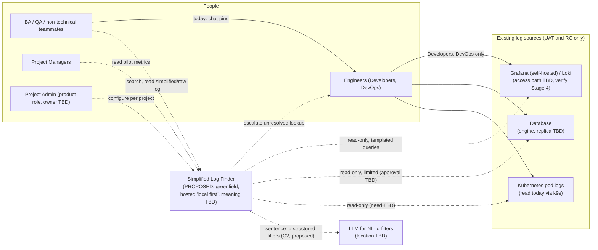

# System Context: Simplified Log Finder

AI-DLC Inception, Stage 1 (Context). Status: **Approved with corrections 2026-11-25**.
Source: `prompt-inception.md` (the brief), cited as `[§x.y]`, plus the user's Stage 1 corrections of 2026-11-25, cited as `[User 2026-11-25]` (see `audit.md` A-006 to A-012). Claims about technologies are taken from the brief and are **unverified for our environment**. No external system was accessed.

**Corrections applied 2026-11-25:** Grafana is self-hosted; only Developers and DevOps use Grafana today; environments in scope are UAT and RC only; hosting is "local first" (meaning still open); the Loki access path is still unknown and is verified by the technical team in Stage 4.

---

## 1. Current log landscape

| Source | What it holds (per brief) | Who can use it today | Notes |
|---|---|---|---|
| Grafana / Loki | Application logs shipped via Fluent Bit, from UAT at least [§1.5] | **Developers and DevOps only** [User 2026-11-25] | Grafana is **self-hosted** [User 2026-11-25]. Loki access path (gateway/proxy, auth): **unknown, verify in Stage 4** [User 2026-11-25]. One Loki per project: working assumption, verify in Stage 4. |
| Database | Application data used during lookups [§1.1, §1.4] | Engineers who can open the database [§1.1]; which roles exactly: **TBD – needs confirmation** | Engines, schemas, tables: **TBD – needs confirmation**. No read-replica: working assumption treated as a risk, verify in Stage 4. |
| Kubernetes pod logs (via k9s) | Container stdout/stderr [§1.4] | Engineers who can open k9s [§1.1]; which roles exactly: **TBD – needs confirmation** | Clusters, namespaces, and whether Loki already holds the same logs: **TBD – needs confirmation**. |

- Environments in scope for the finder: **UAT and RC only**. Production and any other environment are out of MVP scope. [User 2026-11-25]
- Today BA/QA do not use these sources directly; they ask engineers. [§1.1]
- Giving BA/QA direct access is **rejected** by the team. [§1.2]
- Which named engineers hold which access, and through which accounts or RBAC roles: **TBD – needs confirmation**.
- Hosting of the finder: **"local first"** [User 2026-11-25]. Whether this means a developer laptop, an internal Soluix server, or inside the UAT/RC cluster/network: **TBD – needs confirmation** (Stage 2 Blocker question).

## 2. Real log sample shape (Grafana/Loki, UAT) [§1.5]

The sample itself is not in the workspace; this is the description from the brief.

| Aspect | Description |
|---|---|
| Shipping | Fluent Bit |
| Loki labels (examples) | `cluster`, `job`, `kubernetes_container_name` |
| Line wrapper | Each line wraps the application log inside a JSON `"log"` field |
| Noise inside `log` | stdout prefixes, ANSI color codes, nested escaped JSON |
| Application payload fields | `project_name`, `project_module`, `module_version`, `correlation_id`, `log_data` |
| `correlation_id` | Often empty |
| Timestamps | Both UTC and +0700 appear in the same line |
| Sensitive data | Payloads can contain sensitive values (per §1.4: CIF, account numbers, hashcards, tokens, document content) |

Implications noted for later stages (not decisions):
- Identifiers such as CIF or hashcard appear to live inside the payload, not as labels. Whether any identifier is a Loki label: **TBD – needs confirmation**. (Stage 4 must address search cost over wide time ranges.)
- Users speak in local time (WIB, per §4 of the brief) while logs mix UTC and +0700. Timezone rules: **TBD** (Stage 2 question).
- Empty `correlation_id` limits cross-service tracing. Behavior: **TBD** (Stage 2 question).

## 3. Existing-technology landscape [§1.3]

All rows are **claims from the brief, unverified for our environment**.

| Technology | Claimed capability | Claimed limits / caveats | Verification status |
|---|---|---|---|
| Loki HTTP API | Query a time range with LogQL (`query_range`); list labels and label values; multi-tenancy via the `X-Scope-OrgID` header | Authentication is outside Loki's scope, so a gateway or proxy is needed | Unverified for our environment |
| Grafana MCP server (open source) | Tools for querying logs and metrics, searching dashboards, generating deeplinks | Uses a Grafana service account token with RBAC | Unverified for our environment; use against our **self-hosted** Grafana and token RBAC scope: verify in Stage 4 |
| Grafana Assistant | LLM agent built into Grafana Cloud that turns natural language into queries; an assistant-cli can connect agents through an A2A API | Requires a Grafana instance with Assistant enabled; output is not a structured filter set; targets engineers | Unverified. Our Grafana is self-hosted [User 2026-11-25], so per the brief's description Assistant is **likely unavailable**; verify in Stage 4 |
| OpenObserve | Alternative observability platform (replacement for Loki + Grafana) with an NL assistant, MCP server, Fluent Bit ingestion, redaction pipelines | Source is a vendor blog; cost and performance claims treated as marketing | Unverified for our environment |

Relationship to constraints (for Stage 2/4 analysis, not decided here):
- Grafana Assistant's free-form output conflicts with proposed constraint C2 (structured filters only, predefined templates).
- OpenObserve as a replacement conflicts with constraint C4 (must not replace Grafana for engineers) unless used differently.

## 4. What must still be built (differentiators) [§1.3]

1. Business-term dictionary per project
2. Identifier-to-field mapping
3. Parser that turns raw logs into a simplified view
4. Masking and audit
5. Database connector
6. Non-technical UI with editable filter chips
7. Pilot instrumentation

## 5. Context diagram

The finder is **proposed**. Dashed lines are proposed interactions; solid lines exist today.

Notes on the diagram:
- Project Admin is a product role required by §3 Stage 3; who owns it in practice is a Stage 2 question.
- The LLM box does not imply an external service. Whether log content or user sentences may leave Soluix's environment: **TBD – needs confirmation**. This is linked to the "local first" hosting question.
- Kubernetes direct read may be unnecessary if Loki already holds the same logs: **TBD**.
